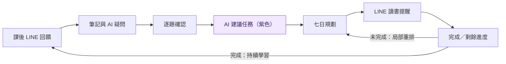
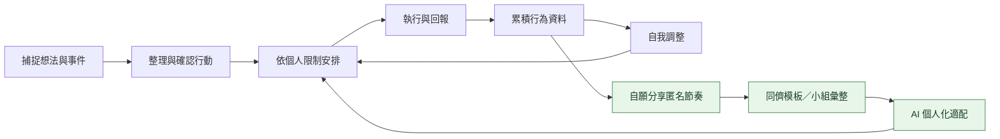

# ClassPulse｜第 14 組 — 主動式學習回饋與規劃助手

> **Final 3.0：已完成本機內部展示驗收；支援離線展示及本機 LINE 服務。**

## Problem｜為什麼需要 ClassPulse？

靈感、疑問與學習心得往往在當下最清楚，卻也最容易在下一個行程開始後流失。即使已經記下筆記，從「知道自己不懂什麼」到「安排時間真正弄懂」仍需要另外整理、規劃與追蹤。傳統筆記、待辦清單與行事曆各自解決一部分問題，使用者卻必須自己維持三者的關聯。

ClassPulse 的出發點是降低這些摩擦：**在想法出現時立即捕捉，在需要行動時提供明確安排，在執行後留下可回顧的資料。** 以學生學習為第一個應用場景，而不是將產品限制為一個課堂筆記工具。

## 核心設計與產品價值

| 設計 | 對使用者的價值 |
| --- | --- |
| LINE 即時筆記與主動回饋 | 使用熟悉的聊天工具記下靈感、疑問或課後心得；支援文字、TXT、DOCX 及文字型 PDF，不必等到有空再整理。 |
| AI 建議任務（紫色） | 經本次同意，由 AI 整理筆記與疑問，使用者逐題決定是否採用。接受後形成可安排的複習任務，不由模型直接覆寫日曆。 |
| Block-based Calendar｜直覺操作 | 任務以可操作的方塊呈現，拖曳位置代表改變時間，拉動把手代表調整所需時長；支援 30 分鐘步進，減少逐欄填表。 |
| Rolling 7-day Planning｜滾動七日規劃 | 從今天 T+0 至 T+6，每天面向當下與未來；已過時段不可再排入。參考中央大學節次標籤，保留午間節次並延伸晚間規劃格；仍可切換日／週／月檢視。 |
| 手動安排與自動安排並存 | 使用者先掌控重要任務，再畫綠色偏好並確認一鍵安排；綠色是優先而非唯一允許時段。 |
| 行事曆互通 | 支援 Google、Outlook、Apple 等行事曆的標準 ICS 檔案匯入及七日計畫匯出，可將計畫帶到支援 ICS 的手機行事曆，並納入外部行程的衝突檢查。 |
| 進度追蹤與自我理解 | 持續保存筆記、課後自評、安排及實際回報，提供任務完成率、LINE 回報指標與 Focus XP；讓使用者回顧自身學習節奏，而非僅看待辦清單。 |
| 同儕學習與 AI 教練 | 自願交換匿名訓練節奏 JSON，或將 2–12 份模板彙整；AI 可將參考節奏適配至自己的課表與期限，建議仍需驗證及確認。 |
| 一站式服務管理 | 已設定的 macOS 環境透過 `classpulse.sh` 管理 Web、LINE 路由及常駐 Worker，統一啟動、狀態檢查、日誌與停止；使用者不需每次手動觸發提醒。 |

## 使用閉環



- [圖解使用手冊：完整閉環、LINE 指令表、狀態流程與架構圖](docs/user-guide.md)
- [跨平台 Demo：不用金鑰即可逐步操作](docs/demo-quickstart.md)

**常用 LINE 指令：** `開啟網頁`、`開啟提醒`、`補筆記`、`AI補筆記`、`查看筆記`、`搜尋 關鍵字`。任務確認及進度回報的指令需在對應狀態下使用，請參閱完整指令表。

## Generalization｜不只學習，也不只單人

核心架構是 **Capture → Interpret → Plan → Act → Feedback → Adapt**。學習是目前完整實作的情境；同一模式可延伸到研究靈感、專案工作、技能訓練等反覆執行與回顧的活動。



目前已支援個人身份映射與匿名模板交換、離線小組節奏彙整；完整共享專案、多人即時協作及其他事件類型仍是延伸方向，而非現成部署能力。參考他人的安排方法，不等於證明對方效率或學力較高；自填指標不是客觀排行榜。ICS 為標準檔案交換，非與外部帳號持續雙向同步。

## 團隊與版本

第 14 組：蕭博軒、莊育哲。原始分工為 A 模組（資料管理、網頁與 AI 分析）及 B 模組（LINE 互動、排程與提醒），最終共同整合為 ClassPulse。

## 主要程式檔案

| 檔案 | 用途 |
| --- | --- |
| `app.py`、`week_board.py` | 網頁控制台、行事曆、任務拖排 |
| `storage.py` | JSON 資料讀寫、驗證與保存 |
| `scheduler.py`、`week_planner.py` | 讀書排程、時間及衝突限制 |
| `line_bot.py`、`line_official_bridge.py` | LINE 訊息接收、筆記與進度回報 |
| `line_web_auth.py` | LINE 登入與個人身份驗證 |
| `ai_assistant.py`、`note_tasks.py` | 筆記分析、疑問及複習任務候選 |
| `reminder_worker.py`、`line_personal_auto_worker.py` | 定期提醒與進度確認 |
| `exporter.py`、`tracker.py` | Markdown 匯出及學習回饋統計 |
| `classpulse.sh`、`deploy/local_service_manager.py` | 本機服務管理 |

## 安裝與離線展示（不需 API 金鑰）

Python 3.11 以上，在專案根目錄執行：

```bash
python3 -m venv .venv
source .venv/bin/activate
python -m pip install -r requirements.txt
python -m streamlit run app.py
```

開啟 Streamlit 網頁，啟用「展示模式」即可操作虛構課表、任務拖排與 LINE Mock。展示模式不發送真實 LINE 或呼叫外部 AI。

### Windows（PowerShell）

建議使用全新 clone，避免覆寫既有資料。安裝 Python 3.11 及 Git 後，在專案根目錄執行：

```powershell
py -3.11 -m venv .venv
.\.venv\Scripts\python.exe -m pip install -r requirements.txt
.\.venv\Scripts\python.exe -m pytest -q
.\.venv\Scripts\python.exe -m streamlit run app.py
```

開啟 http://localhost:8501，啟用展示模式，再按「重設展示資料」（只還原虛構展示資料）。不需要啟用 PowerShell script execution policy、LINE Token、Gemini API Key、Caddy 或 Tunnel。按 Ctrl+C 停止本機網頁。

- [跨平台 Demo 操作手冊](docs/demo-quickstart.md)
- Windows CI 執行離線測試、Chromium UI 測試及本機 HTTP health check；POSIX 權限相關的 macOS launcher 測試在 Windows 明確略過。完整真實 LINE 服務管理仍為 macOS 內部環境，不宣稱 Windows 原生支援。

## AI 使用說明

開發過程使用 AI 協助規格、程式、除錯與文件，實際採用內容經人工判斷及測試；過程見 [AI 協作紀錄](docs/ai-log.md)。產品內建 AI 用於筆記整理與疑問候選，須使用者同意才連外；任務與排程由使用者確認，合法性由程式規則檢查。

- [本機一鍵啟動與維運](docs/local-launcher.md)
- [主線整合與驗收規則](docs/main-integration-plan.md)

### 啟動已設定好的 macOS 內部展示服務

```bash
bash classpulse.sh start
```

既有 staging 環境、原始 Flask 5000 及現有 HTTPS Tunnel 為前置條件。另一個 Terminal 可使用 `bash classpulse.sh status`、`bash classpulse.sh logs worker`、`bash classpulse.sh stop`。第一次設定請閱讀維運手冊；不要將 Token、環境檔或個人資料提交至 GitHub。公開部署、雙帳號實機及新 Tunnel 模式尚未驗收。

---

## 專案文件

- [專題規格書](spec_第14組.md)
- [圖解使用手冊](docs/user-guide.md)
- [AI 協作紀錄](docs/ai-log.md)
- [系統架構](docs/architecture-v2.md)
- [服務管理](docs/local-launcher.md)

## 自動化測試

    python -m pytest -q

測試使用隔離資料與外部服務替身，不需要真實 API 金鑰。
