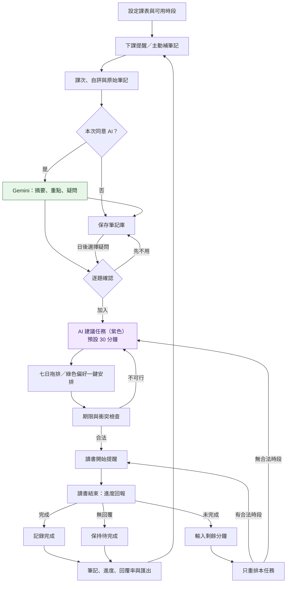
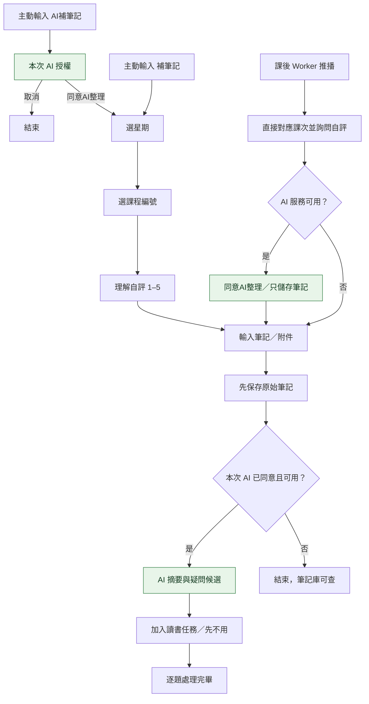
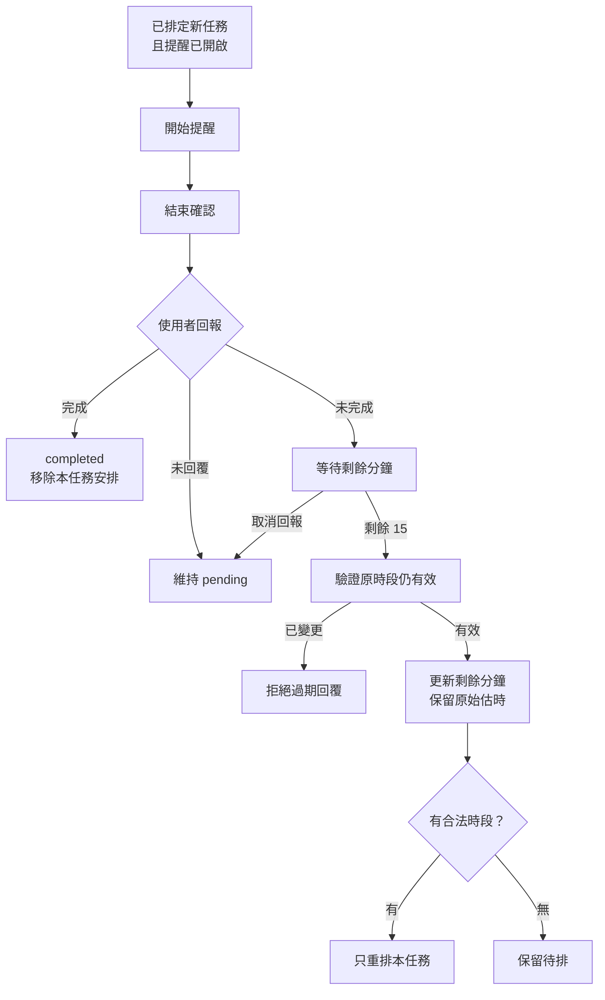
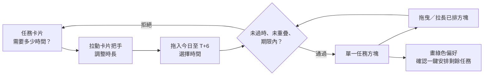
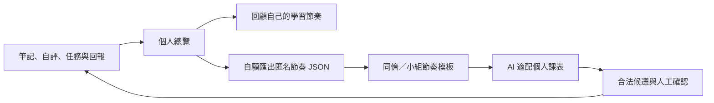
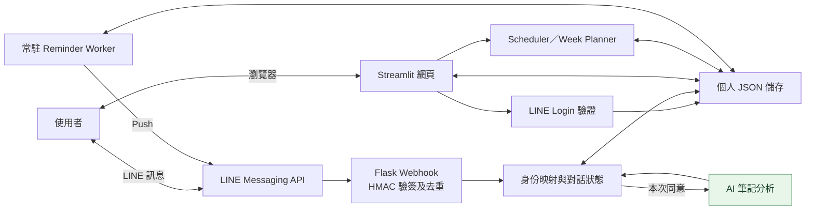

# ClassPulse｜Final 3.0 圖解使用手冊

> 本手冊以目前 main 的個人 LINE 內部展示模式為主。無 API 金鑰時可依 [跨平台 Demo](demo-quickstart.md) 使用離線展示；Legacy 綁定模式不是以下逐題確認流程的同義詞。

## 1. 使用閉環

ClassPulse 將課後難以追蹤的疑問轉成下一次可執行的學習行動，再以實際回報修正後續安排。LINE 負責日常互動，網頁負責全局規劃，AI 負責理解筆記，排程器負責執行硬限制。

圖一：學習閉環。AI 建議任務（紫色）表示已確認的複習任務；尚未指定時間時位於待排區；AI 不直接改動日曆。

## 2. 第一次使用與日常操作

| 步驟 | 使用者操作 | 系統結果 |
| --- | --- | --- |
| 1. 進入 | 加入已設定的 LINE 官方帳號，或輸入 `開啟網頁`，使用外部瀏覽器完成 LINE Login | 建立或取得個人展示空間；身份由 LINE 驗證，不靠 URL 傳遞使用者 ID |
| 2. 設定 | 在網頁進階設定核對課程與可用時段 | 課表及排程資料保存於個人空間 |
| 3. 開啟提醒 | LINE 輸入 `開啟提醒` | 使用者選擇接收課後及讀書提醒；須有常駐服務 |
| 4. 課後回饋 | 回覆課後推播，或主動輸入 `補筆記`／`AI補筆記` | 保存課次、自評、文字或支援附件 |
| 5. AI 複習 | 閱讀資料使用說明並同意；逐題選擇加入或略過 | 保留原始筆記；接受的疑問成為AI 建議任務卡（紫色） |
| 6. 安排 | 在七日板拖放、伸縮，或設定綠色偏好後確認一鍵安排 | 檢查期限、空檔與重疊；不任意移動固定任務 |
| 7. 執行 | 收到讀書開始與結束提醒；回報完成／未完成及剩餘分鐘 | 記錄完成或僅調整該任務；無空檔時保留待排 |
| 8. 檢視 | 總覽與回饋、筆記庫、Markdown 與 AI | 檢索筆記、追蹤回覆與進度、匯出學習資料 |

內部展示初次登入會建立虛構範例資料。提醒 Worker 不會針對原始種子課程／種子任務自動發送真實推播；真實展示請新增非種子測試課程或使用實際確認並安排的新任務。內部模式最多兩個席位，非公開服務。

## 3. LINE 指令功能表（個人模式）

指令請依照下列寫法，含半形空格的指令需保留空格。數字及確認文字依目前對話狀態解讀，不能把所有輸入視為全域指令。

| 關鍵詞或輸入 | 使用時機 | 作用 |
| --- | --- | --- |
| `開啟網頁` | 官方帳號私聊 | 取得個人網頁入口；仍須 LINE Login |
| `開啟提醒` | 登入後，服務已啟用 | 開啟課後與讀書提醒 |
| `關閉提醒` | 登入後 | 停止未來主動推播，不撤回已送訊息 |
| `提醒狀態` | 登入後 | 查詢提醒授權 |
| `補筆記` | 主動新增課堂回饋 | 選星期、課程、自評，再保存筆記；一般流程不呼叫付費 AI |
| `AI補筆記` | AI 服務已啟用 | 顯示本次資料使用說明 |
| `同意AI整理` | AI 授權提示後 | 同意本次筆記分析，不永久授權 |
| `只儲存筆記` | 課後推播的 AI 選擇階段 | 不呼叫模型，繼續保存原始筆記 |
| `週一` 至 `週日` | 星期選擇階段 | 亦接受星期一至星期日、星期天或 1–7 |
| 課程清單編號 | 課程選擇階段 | 選擇課名及對應時段，定位最近已結束課次 |
| `1` 至 `5` | 理解自評階段 | 1 為不熟悉，3 為部分理解，5 為有把握 |
| 筆記文字或 TXT／DOCX／文字型 PDF | 筆記階段 | 保存內容；PDF 可保留原檔供網頁下載 |
| `筆記 電容在高頻的影響？` | 無進行中筆記流程 | 快速儲存未分類筆記，不自動建立任務 |
| 直接傳送支援檔案 | 無進行中筆記流程 | 快速擷取內容並保存至未分類筆記庫 |
| `查看筆記`／`我的筆記` | 無進行中筆記流程 | 查詢個人筆記 |
| `搜尋 MOS` | 無進行中筆記流程 | 搜尋筆記文字、主題等相關內容 |
| `加入讀書任務` | AI 疑問確認階段 | 接受目前這一題，建立AI 建議任務卡（紫色） |
| `先不用` | AI 疑問確認階段 | 略過目前這一題，保留筆記 |
| `取消` | 筆記、AI 授權或疑問確認階段 | 結束暫存流程；不刪除已保存的筆記或已確認任務 |
| `完成` 或 `完成 任務代碼` | 收到讀書結束確認後 | 標記指定任務完成 |
| `未完成` 或 `未完成 任務代碼` | 收到讀書結束確認後 | 等待剩餘時間 |
| `剩餘 15` 或 `剩餘 任務代碼 15` | 未完成後 | 記錄 1–240 分鐘，只重排該任務 |
| `取消回報` 或 `取消回報 任務代碼` | 等待剩餘分鐘時 | 結束該次進度回報，任務仍待完成 |

若有多項待回報任務，使用提醒中提供的任務代碼。裸數字在個人進度回報中不是剩餘分鐘指令。Legacy 模式另有管理者配置的 `綁定 綁定碼`，不是個人 LINE Login 的必要步驟。

### 3.1 手動與主動回饋的差別

圖二：LINE 有限狀態互動。手動補筆記需選課次；課後推播已知道課次，因此縮短使用者操作。筆記暫存流程有逾時機制，AI 授權只限本次；API 失敗時原始筆記仍保存，不新增虛構模型結果。支援 UTF-8 TXT、DOCX、可擷取文字的 PDF，不提供掃描 PDF OCR。

### 3.2 讀書進度回報

圖三：進度狀態轉移。時段採 30 分鐘格，剩餘 15 分鐘仍可占一個 30 分鐘格；不會將自評或沉默解讀成完成。

## 4. 網頁功能位置

| 頁籤 | 用途 |
| --- | --- |
| 行事曆與拖排 | 七日規劃板、日週月切換、課表與外部 ICS、手排及綠色偏好 |
| 操作引導 | 依序理解課表、任務、偏好與 AI |
| LINE 一日 Mock | 離線示範按鈕引導、補筆記與模擬提醒 |
| 任務管理 | 任務、來源疑問及紫色候選確認 |
| 總覽與回饋 | 可搜尋筆記庫、課後回覆率、完成率與學習回饋 |
| Markdown 與 AI | 匯出學習資料，供使用者自行決定是否分享 |

### 4.1 Block-based Calendar：直接操作時間

七日規劃板採用中央大學學生熟悉的節次標籤（1–4、Z、5–9、A–D），另延伸 E/F 晚間規劃格。以每小時規劃格再細分 30 分鐘操作單位，不等同校方正式每節上課長度。

圖：直接操作與驗證。位置對應開始時間，長度對應所需時長。待排卡片可用右側把手伸縮，已排方塊可透過下方把手調整；操作由後端重新驗證。拖動一件事不等於授權重排全部事項。

滾動七日是「規劃」視圖，而日／週／月是「檢視」視圖。前者集中在今天與可立即行動的未來六天，拒絕排入已經過去的格子，後者仍可用於查看其他日期與較長期行程。

### 4.2 與手機行事曆互通

在「行事曆與拖排」展開外部行事曆功能，選擇 Google／Outlook／Apple 等來源的 ICS 檔案，預覽並確認匯入。外部活動會參與衝突檢查。完成規劃後，下載「匯出七日行事曆（ICS）」，透過支援 ICS 的行事曆應用程式匯入手機或電腦。

這是標準檔案互通；匯入後的變更屬於 ClassPulse 本機副本，不會自動寫回外部帳號或持續雙向同步。

### 4.3 自我追蹤與向他人學習

在「總覽與回饋」檢視任務完成率、LINE 回報完成率、課後提醒回覆率及 Focus XP，並開啟 AI 訓練教練。匯出匿名模板可與同學自願交換；一次可合成 2–12 份模板，使用中位數與時段頻數彙整訓練節奏，再按自身課表與限制產生候選。示範模板是虛構資料，真實同儕提供的數值也未獨立驗證，不能據此評定學力或排名。

## 5. 系統資料流與責任分工

圖四：邏輯架構（省略內部路由與 Tunnel 細節）。AI 接收課名、筆記文字與自評，不需傳送 LINE ID 或整份 PDF 原檔。身份、授權、資料驗證、排程與提醒均由程式處理。自動 Worker 不會另行呼叫模型。

### 5.1 一站式服務管理

已設定的 macOS 內部環境以 `bash classpulse.sh start` 啟動服務；`status` 檢查狀態、`logs worker` 查看提醒日誌、`stop` 停止管理器擁有的服務。常駐 Worker 自動輪詢到期課程與已安排的任務，不需使用者逐次選擇推播。現有原始 Flask 及 HTTPS Tunnel 是前置條件，不由一般啟停操作任意關閉。

### 5.2 泛化能力

學習情境可抽象為「想法／事件 → 捕捉 → 整理 → 形成任務 → 安排 → 執行回報 → 調整」。目前課程、筆記、任務、提醒、身份與匯出已模組化，匿名模板交換也建立了由個人經驗延伸到同儕學習的資料介面。研究靈感追蹤、專案管理、運動與技能訓練可以沿用這一設計方向；仍需擴充事件規則、資料欄位、權限及多人協作介面，不能宣稱已完成通用協作平台。

## 6. 驗收與適用邊界

- **跨平台離線展示**：Windows/Linux CI #280 均通過 Python 回歸、Chromium UI 與 HTTP health check；Windows 略過兩個 POSIX 權限測試。macOS 本機合併前回歸為 230 項通過。
- **真實 LINE/Gemini**：已在先前封存的 Final 3.0 內部環境進行單一使用者實機操作；整合後未重新完成完整雙帳號驗收或正式雲端部署。
- **資料可靠性**：單檔鎖與原子寫入、Webhook 去重及推播重試識別；多檔案並非完整資料庫交易。提醒須具有效時間、授權與常駐服務；API 接受不保證手機實際讀取。
- **展示規則**：離線 Mock 不會發出真實 LINE 訊息或呼叫外部模型。參見 [跨平台 Demo 手冊](demo-quickstart.md) 與 [本機維運](local-launcher.md)。
- [CI #280](https://github.com/joeuser-max/python-14-studybot/actions/runs/46084415055)｜[LINE Bot](../line_bot.py)｜[LINE Bridge](../line_official_bridge.py)｜[個人進度回報](../line_personal_progress.py)｜[自動 Worker](../line_personal_auto_worker.py)｜[疑問任務](../note_tasks.py)
